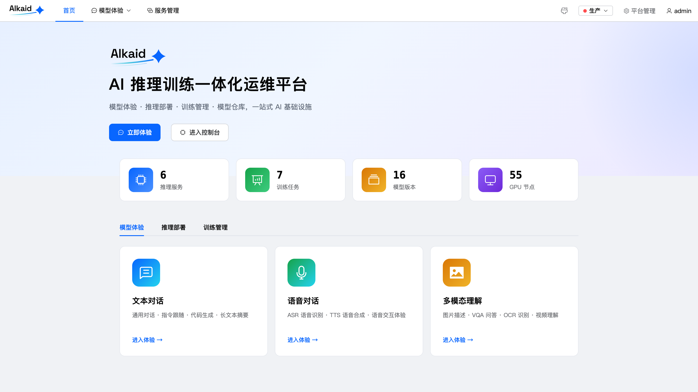
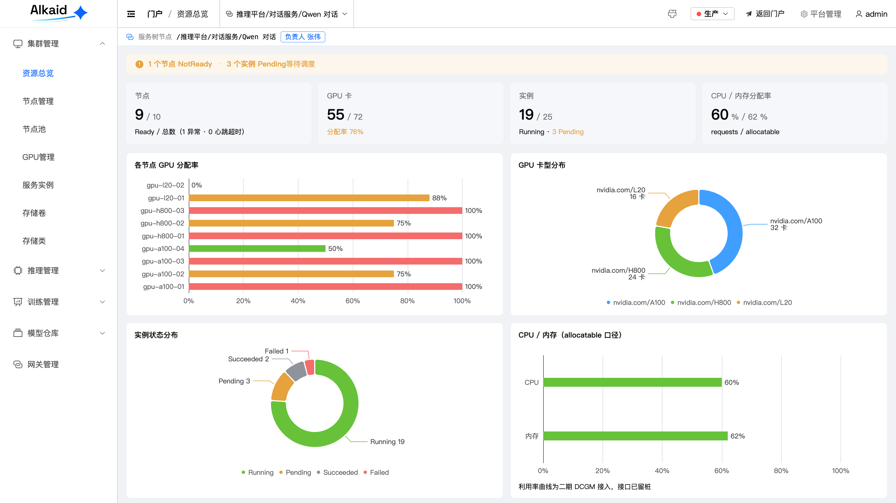
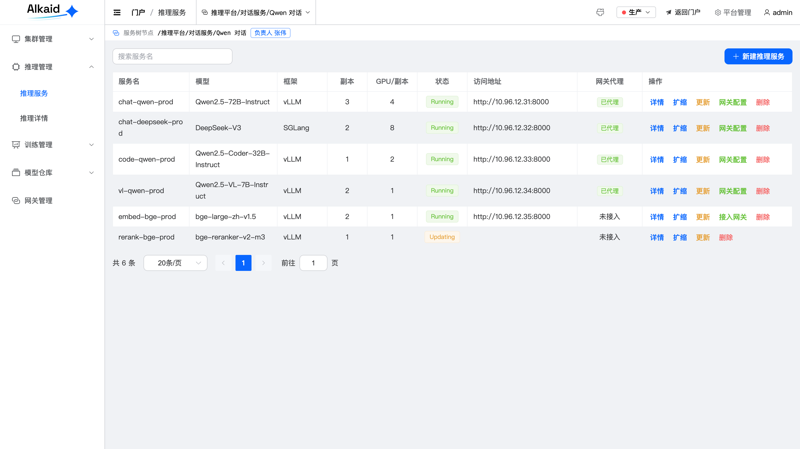
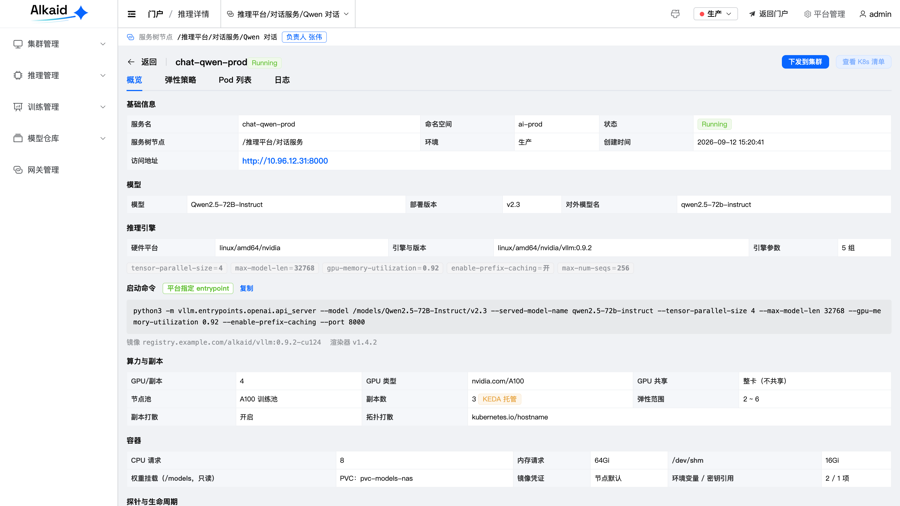
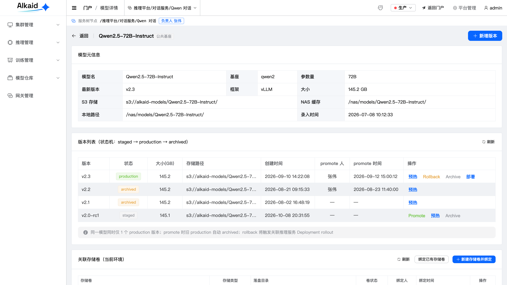
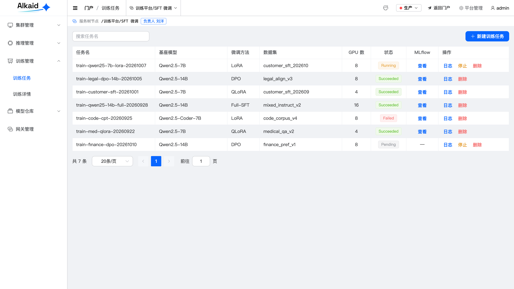
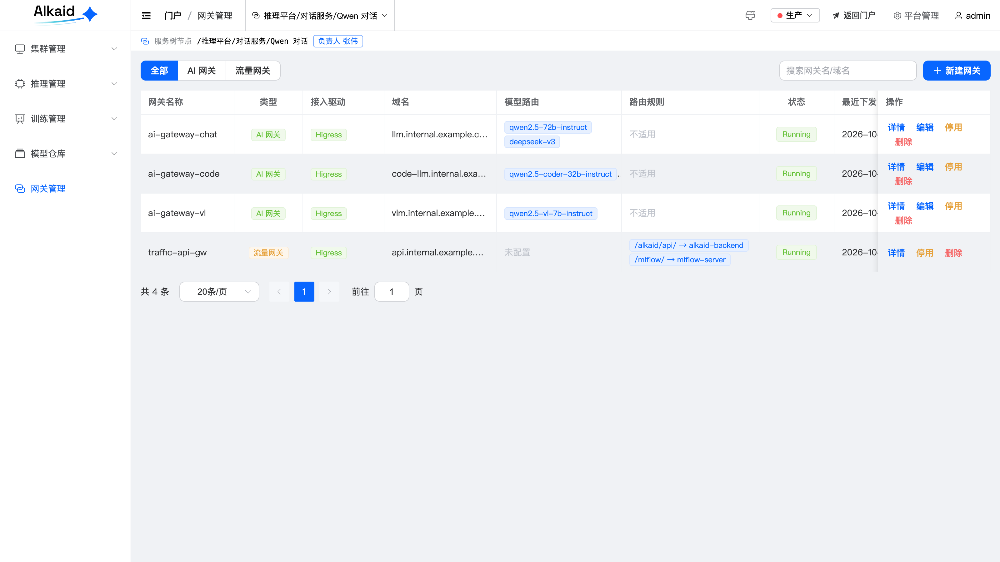
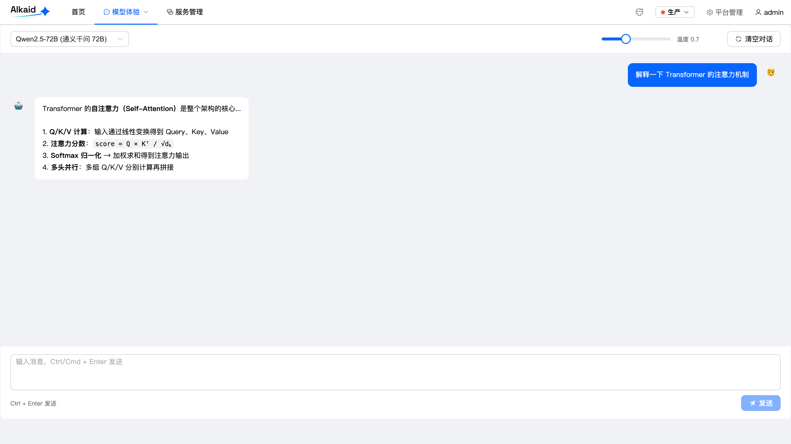

# Alkaid 瑶光

> AI 推理训练一体化运维平台 —— 让算法工程师一条龙完成「训练 → 模型产出 → 推理部署 → 上线运维」。

Alkaid 构建在已有的 Kubernetes 集群、模型仓库与网关之上，专注做**编排、纳管与自助运维**层，不重复造底层。平台对 vLLM / SGLang 一视同仁，用 KEDA 做 LLM 场景弹性，用 Higress/LiteLLM 提供 AI 网关与 KV-cache-aware 智能路由。

## 核心特性

| 模块 | 能力 |
|---|---|
| **推理部署** | 裸部署（Deployment + Service）+ 滚动更新 + 模型预热；对 vLLM / SGLang 统一支持 |
| **弹性伸缩** | KEDA ScaledObject，以 `num_requests_waiting` / `kv_cache_usage_perc` 为信号；支持缩零 + cron 保 warm |
| **AI 网关** | Higress/LiteLLM 统一网关：ai-proxy、InferencePool + EPP 智能路由、灰度 canary、语义缓存、token 限流 |
| **模型管理** | 模型元数据 + 版本状态机（staged / production / archived），权重存对象存储、平台只存元数据与路径 |
| **训练任务** | 原生 Job + Volcano Gang 调度，LLaMA-Factory 微调，FSDP / FSDP2 并行 |
| **实验追踪** | 自建 MLflow（MySQL backend + 对象存储 artifact），数据不出网 |
| **基础能力** | 服务树、CMDB 动态建模、环境隔离、RBAC、终端与日志 |
| **可观测性** | Prometheus + Grafana 指标看板（含 DCGM GPU 指标）、模板化报警、Pod 日志采集 |

## 界面预览

> 以下截图为**演示数据**（非真实生产数据），用于展示界面形态；更多截图见 [docs/images](docs/images)。

| 门户首页 | 集群资源总览 |
|---|---|
|  |  |
| **推理服务列表** | **推理服务详情** |
|  |  |
| **模型版本状态机** | **训练任务** |
|  |  |
| **AI 网关** | **模型体验** |
|  |  |

## 架构

```
                        ┌──────────────────┐
   [用户] ─────────────▶│  Vue3 前端        │
                        └────────┬─────────┘
                                 │ HTTP / SSE
                        ┌────────▼─────────┐
                        │  Higress 网关     │  AI 网关 + 流量网关
                        │  (InferencePool)  │  灰度 / 鉴权 / 语义缓存
                        └────────┬─────────┘
                                 │
              ┌──────────────────▼───────────────────┐
              │  控制面（namespace: alkaid）           │
              │  backend (Go + Gin)  │  frontend      │
              │  MySQL  │  服务树 / CMDB             │
              │  MLflow │  Prometheus + Grafana      │
              └──────────────────┬───────────────────┘
                                 │ client-go / HTTP API
              ┌──────────────────▼───────────────────┐
              │  数据面（K8s 业务 namespace）          │
              │  推理：[vLLM/SGLang Deployment]       │
              │        + [Service] + [KEDA ScaledObject]
              │  训练：[batch/v1 Job] + Volcano       │
              └──────────────────────────────────────┘
```

## 技术栈

- **前端**：Vue 3 + TypeScript + Element Plus + Pinia + Vite
- **后端**：Go + Gin + MySQL（GORM）
- **平台依赖**：Kubernetes、Higress、KEDA、Volcano、Prometheus/Grafana、MLflow
- **设计原则**：云中立、可移植。日志 / 监控 / 对象存储等可替换后端统一走 interface 抽象 + 启动时注入实现

## 目录结构

```
alkaid/
├── frontend/            # Vue3 前端
│   ├── src/
│   │   ├── api/         # 接口层
│   │   ├── stores/      # Pinia 状态
│   │   ├── views/       # 页面（cluster / inference / training / system …）
│   │   ├── layout/      # 布局与侧边栏
│   │   └── utils/       # 请求 / SSE / 工具
│   └── package.json
├── backend/             # Go 后端（迁入中）
├── LICENSE              # Apache-2.0
└── README.md
```

## 快速开始（前端）

### 环境要求

- Node.js >= 18
- npm >= 9

### 启动

```bash
git clone <repo-url> alkaid
cd alkaid/frontend
npm install
npm run dev
```

默认访问 http://localhost:5173 ，开发服务器会把 `/api` 代理到后端 `http://localhost:8080`（见 `.env.development`）。

### 构建

```bash
npm run build      # 产物输出到 dist/
npm run typecheck  # vue-tsc 类型检查
```

### 配置说明

| 变量 | 开发默认 | 说明 |
|---|---|---|
| `VITE_API_URL` | `http://localhost:8080` | 后端 API 基地址 |
| `VITE_PORT` | `5173` | 开发服务器端口 |

生产环境 `.env.production` 使用 `VITE_API_URL=/api`，由网关统一反代。

## 后端

后端（Go + Gin）目前正在做开源前的配置脱敏与结构整理，稍后迁入 `backend/` 目录。迁入后本 README 会补齐后端的环境要求、配置项与启动方式。

## 参与贡献

欢迎提交 Issue 与 Pull Request。开始之前请先阅读 [CONTRIBUTING.md](CONTRIBUTING.md)。

项目采用 [Contributor Covenant](https://www.contributor-covenant.org/) 行为准则，参与即表示同意遵守。

## 安全

如果发现安全漏洞，请**不要**开公开 Issue，按 [SECURITY.md](SECURITY.md) 的渠道私下上报。

## 许可证

本项目基于 [Apache License 2.0](LICENSE) 开源。

Copyright 2026 The Alkaid Authors
